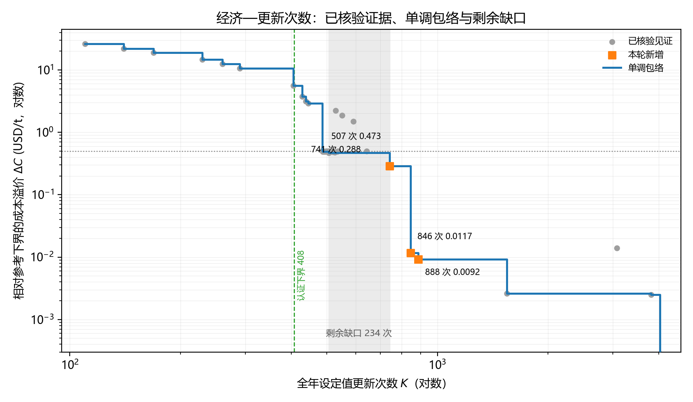

# 经济—更新次数帕累托前沿

> 由 `run_frontier.m` 自动生成，请勿手工编辑。
> 基准参考成本：$L_C=31747614.090131$，$U_C=31747636.626430$ USD；年产量 $Q=80000$ t/a；跟踪带宽 0.0100。

## 1. 问题与口径

对每个经济容许损失 $\delta$，求解

$$K(\delta)=\min\,N(x)\quad\text{s.t.}\quad C(x)\le L_C+\delta Q .$$

这里用参考成本的**下界** $L_C$ 作预算基准，因此所得 $K$ 相对真实最优预算偏保守（预算更紧）。成本溢价定义为 $\Delta C=C-L_C$，与 $\delta$ 同一坐标轴。

## 2. $\delta$ 网格

取 $\delta=0.05:0.05:0.50$，共 10 点。规则：

1. 全部是 0.05 的整数倍，直接对应"每吨氨多花 5 美分"的工程口径；
2. 上界 0.50 覆盖 487 次解所需的预算（该解溢价 0.4917 USD/t），再往上预算已不能显著降低更新次数；
3. 单点时限 240 s，热启动取证据池中满足该预算且更新最少的可行解。

## 3. 结果

| $\delta$ (USD/t) | 预算帽 (USD) | 证据池最少$K$ | 本次$K$ | 单调$K$ | $K$下界 | 成本 (USD) | 溢价 (USD/t) | 状态 |
|---:|---:|---:|---:|---:|---:|---:|---:|---|
| 0.05 | 31751614 | 1544 | 1432 | 1432 | 401 | 31751614.090 | 0.050000 | TIME_LIMIT |
| 0.10 | 31755614 | 1544 | 1485 | 1432 | 376 | 31752562.722 | 0.061858 | TIME_LIMIT |
| 0.15 | 31759614 | 1544 | 1483 | 1432 | 371 | 31757865.549 | 0.128143 | TIME_LIMIT |
| 0.20 | 31763614 | 1544 | 1482 | 1432 | 369 | 31760793.148 | 0.164738 | TIME_LIMIT |
| 0.25 | 31767614 | 1544 | 1418 | 1418 | 367 | 31767614.090 | 0.250000 | TIME_LIMIT |
| 0.30 | 31771614 | 1544 | 1482 | 1418 | 366 | 31770843.584 | 0.290369 | TIME_LIMIT |
| 0.35 | 31775614 | 1544 | 1481 | 1418 | 364 | 31772148.010 | 0.306674 | TIME_LIMIT |
| 0.40 | 31779614 | 1544 | 1482 | 1418 | 363 | 31776854.807 | 0.365509 | TIME_LIMIT |
| 0.45 | 31783614 | 1544 | 1483 | 1418 | 361 | 31782365.900 | 0.434398 | TIME_LIMIT |
| 0.50 | 31787614 | 487 | 487 | 487 | 360 | 31786951.384 | 0.491716 | TIME_LIMIT |

### 3.1 综合前沿（全部证据的下包络）

把证据池与本次求解合并，只保留"更新更少且成本更低"不被支配的点。这张表才是前沿本身，第 3 节按 $\delta$ 列出的只是每个预算下的单点结果。

| $K$ | 成本 (USD) | 溢价 (USD/t) |
|---:|---:|---:|
| 110 | 26.100 | -396.844850 |
| 140 | 21.961 | -396.844902 |
| 169 | 18.966 | -396.844939 |
| 229 | 14.677 | -396.844993 |
| 260 | 12.513 | -396.845020 |
| 290 | 10.632 | -396.845043 |
| 405 | 5.586 | -396.845106 |
| 429 | 3.743 | -396.845129 |
| 438 | 3.137 | -396.845137 |
| 445 | 2.899 | -396.845140 |
| 486 | 0.504 | -396.845170 |
| 487 | 0.492 | -396.845170 |
| 492 | 0.490 | -396.845170 |
| 496 | 0.490 | -396.845170 |
| 507 | 0.473 | -396.845170 |
| 741 | 0.288 | -396.845173 |
| 846 | 0.012 | -396.845176 |
| 888 | 0.009 | -396.845176 |
| 1544 | 0.003 | -396.845176 |
| 3815 | 0.002 | -396.845176 |
| 4029 | 0.000 | -396.845176 |

> 其中 $K=1290$ 来自 $\delta=0.25$ 的 1800 s 加时试点（较 240 s 的 1418 次减少 9%，对偶间隙仍为 71.6%）；其余点来自 240 s 网格。加时有效但不显著，说明瓶颈是整数规划的对偶间隙，而不是计算时间。

## 4. 与证据池的对照

证据池指缓存中已有、且都通过原年度矩阵核验的可行解，共 48 条。下表比较"只用现有证据"与"本批求解"得到的 $K$：

| $\delta$ | 证据池 $K$ | 本次 $K$ | 是否改进 |
|---:|---:|---:|---|
| 0.05 | 1544 | 1432 | 是 |
| 0.10 | 1544 | 1485 | 是 |
| 0.15 | 1544 | 1483 | 是 |
| 0.20 | 1544 | 1482 | 是 |
| 0.25 | 1544 | 1418 | 是 |
| 0.30 | 1544 | 1482 | 是 |
| 0.35 | 1544 | 1481 | 是 |
| 0.40 | 1544 | 1482 | 是 |
| 0.45 | 1544 | 1483 | 是 |
| 0.50 | 487 | 487 | 否 |

## 5. 前沿形状



横轴为全年设定值更新次数 $K$（对数），纵轴为相对参考下界的成本溢价 $\Delta C$（USD/t，对数）。灰点为全部已核验见证，橙点为新增的 $F(K)$ 求解点，蓝线为单调包络（按 $K$ 升序只保留"成本创新低"的点，故严格单调递减），绿色虚线为认证下界 408，灰色带为当前无证据支撑的区间。

读法：

- $\delta\le0.45$ 的 9 个点，$K$ 落在 1418—1485，极差 67 次（4.7%），且无单调趋势；说明该区间内增加预算没有换来更少更新，前沿只给出上界。
- $\delta=0.50$ 处 $K$ 降到 487（约为前一段的 1/3），来自证据池中已有的低更新解，不是本次搜索的成果。
- 因此该前沿呈"平台 + 断崖"形状；落差来自证据缺口，不能解释为系统在某个预算处突然获得柔性。

## 6. 证据边界

- 每个点的 $K$ 只有**上界**由可行解给出；下界来自该点 Gurobi 的全局界，通常远弱于分区证书，不能当作认证下界。
- 热启动沿用证据池中的解，只会抬高起点，不会缩小可行域；若某点未改进，说明该预算下本次时限未能找到更少更新的调度。
- 预算帽以 $L_C$ 为基准，比主程序双帽中的 $\tau_{\mathrm{sat}}=L_C+\delta Q$ 更紧；因此本表 $K$ 相对主程序口径偏大。
- 本次总耗时 46.5 min，单点 240 s；延长时限可能继续降低 $K$，但不保证收敛。

## 7. 复现

```matlab
cd test/10_30
run('run_frontier.m')
```
