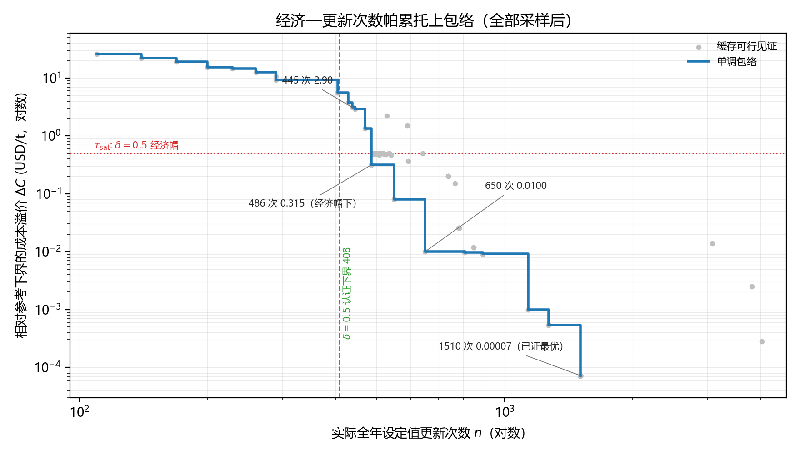

# 经济—更新次数帕累托前沿

> 数值来源：`src/cache/O1_economic_threshold_partition21_cache.mat`。该缓存含 90 条带可行解的记录，其中 47 条经主程序原矩阵重核。本文表格由缓存导出，正文解读为人工撰写。
> 基准量：参考成本下界 $L_C=31\,747\,614.090131$ USD，参考可行上界 $U_C=31\,747\,636.626430$ USD，年产量 $Q=80\,000$ t/a，跟踪总带宽 $\varepsilon_h=0.01$。

## 1. 问题与口径

对固定更新上限 $k$，记

$$F(k)=\min_{x\in\mathcal X,\,N(x)\le k} C(x),\qquad \Delta C(k)=\frac{F(k)-L_C}{Q}.$$

前沿即 $(k,\Delta C)$ 的单调包络。三点口径必须说明：

1. **每条记录给的是一个区间，不是一个点。** 表中成本 $C$ 是已核验可行解，满足 $C\ge F(k)$；同次求解的 Gurobi 全局界 $C_L$ 满足 $C_L\le F(k)$。因此 $F(k)\in[C_L,C]$。除个别点外，本表大部分点的区间宽度与溢价同量级（见第 6 节），故这条线应称为**经验上包络**，不能写作精确 $F(k)$。
2. **横轴用实际更新次数 $K$，不用采样上限 $k$。** 求解 `min C s.t. N ≤ k` 时，最优解未必用满 $k$（例如 $k=550$ 得到 $n=541$）。若用 $k$ 作横轴，会把所需预算高估。
3. **预算帽与主程序同口径。** 本表预算帽为 $L_C+\delta Q$，与主程序严格帽 $\tau_{\mathrm{sat}}=L_C+\Delta$ 完全一致；主程序另有宽松帽 $\tau_{\mathrm{fail}}=U_C+\Delta$，本表不使用。

## 2. 采样

逐点求解固定 $k$ 的最小成本问题，热启动取自"满足该 $k$、成本最低"的已核验解。共五轮、约 21 小时机时：

| 轮次 | K 集合 | 单点时限 |
|---|---|---:|
| 一 | 480、520、580—720（步长 20—40）、780—840（步长 20）、865、900、1000—2000（步长 200）、2200—4000 | 600—3000 s |
| 二 | 730、740、750、760、770、1100、1300 | 1500—1800 s |
| 三 | 810、830、1000、1150、1220、1350、1450 | 1800 s |
| 四 | 950、1050、1400 | 2400 s |
| 五 | 486、487、470、445、200、350、415、405、290 | 2400—7200 s |

同一 $K$ 可能由多个 $k$ 得到（例如 $n=541$ 由 550、580、600、620、650、660、700、720 八个 $k$ 得到，成本完全相同），表中只保留成本最低者。

## 3. 包络点

按 $K$ 升序扫描缓存，只保留"成本严格创新低"的点：

| $K$（实际更新次数） | 成本 (USD) | 溢价 (USD/t) | 区间宽度 (USD) | 与下一点的 $\Delta K$ |
|---:|---:|---:|---:|---:|
| 110 | 33,835,642.036 | 26.100349 | 2,088,027.9 | 30 |
| 140 | 33,504,533.955 | 21.961498 | 1,756,919.9 | 29 |
| 169 | 33,264,897.389 | 18.966041 | 1,517,283.3 | 31 |
| 200 | 32,971,564.034 | 15.299374 | 316,911.7 | 29 |
| 229 | 32,921,742.029 | 14.676599 | 1,174,127.9 | 31 |
| 260 | 32,748,659.697 | 12.513070 | 1,001,045.6 | 30 |
| 290 | 32,484,493.821 | 9.210997 | 420,605.2 | 115 |
| 405 | 32,194,523.006 | 5.586361 | 443,431.3 | 24 |
| 429 | 32,047,042.010 | 3.742849 | 299,427.9 | 9 |
| 438 | 31,998,592.886 | 3.137235 | 250,978.8 | 7 |
| 445 | 31,979,538.866 | 2.899060 | 231,308.7 | 25 |
| 470 | 31,854,847.961 | 1.340423 | 107,240.5 | 16 |
| 486 | 31,772,848.004 | 0.315424 | 25,230.5 | 64 |
| 550 | 31,754,086.015 | 0.080899 | 6,468.5 | 100 |
| 650 | 31,748,412.495 | 0.009980 | 795.3 | 156 |
| 806 | 31,748,386.381 | 0.009654 | 778.9 | 82 |
| 888 | 31,748,350.413 | 0.009204 | 743.0 | 248 |
| 1136 | 31,747,693.161 | 0.000988 | 82.4 | 134 |
| 1270 | 31,747,657.463 | 0.000542 | 37.7 | 240 |
| 1510 | 31,747,619.819 | 0.000072 | 0.0 |  |

## 4. 各经济预算下的最少更新次数

由第 3 节的点直接读出：预算帽 $L_C+\delta Q$ 下，满足成本上限的包络点中 $K$ 最小者。

| $\delta$ (USD/t) | 预算帽 (USD) | 最少更新次数 | 对应溢价 (USD/t) |
|---:|---:|---:|---:|
| 0.05 | 31,751,614 | 650 | 0.009980 |
| 0.10 | 31,755,614 | 550 | 0.080899 |
| 0.15 | 31,759,614 | 550 | 0.080899 |
| 0.20 | 31,763,614 | 550 | 0.080899 |
| 0.25 | 31,767,614 | 550 | 0.080899 |
| 0.30 | 31,771,614 | 550 | 0.080899 |
| 0.35 | 31,775,614 | 486 | 0.315424 |
| 0.40 | 31,779,614 | 486 | 0.315424 |
| 0.45 | 31,783,614 | 486 | 0.315424 |
| 0.50 | 31,787,614 | 486 | 0.315424 |

注意：这张表与第 3 节不是一回事——第 3 节是 $(n,\Delta C)$ 平面上的前沿，本表是它在 $\delta$ 轴上的读取结果。两者此前版本曾出现冲突，现已统一由同一缓存导出。

## 5. 前沿形状



横轴为实际更新次数 $K$（对数），纵轴为溢价 $\Delta C$（USD/t，对数）。灰点为缓存中的可行见证，蓝线为单调包络。绿色虚线为 $\delta=0.5$ 主结果的认证下界 408——**它只在该经济预算下有效，不适用于更高溢价的左侧区段**。点线为 $\delta=0.5$ USD/t。

读法：

- **K_eco 上界为 486**：固定 $k=486$ 的 7200 s 求解得到 486 次、成本 31,772,848.004（溢价 0.3154 USD/t），比 $\delta=0.5$ 的经济帽 31,787,614.09 低约 14,766 USD，故 $K_{\mathrm{eco}}\in[408,486]$。
- **486—806 段已被填满**：550 次（0.0809）、650 次（0.00998）把原先 250 次的空档拆成 64、100、156 三格，全部落在 200 以内。
- **约 1510 次达到已核验的最低成本**：溢价 0.000072 USD/t（5.7 USD/年），比原先 4029 次的参考解（0.000282）还低 16.8 USD/年；该点是全部记录中唯一对偶间隙接近于零的（0.03 USD）。
- **陡升发生在 486 次以下**：445 次（2.899）、405 次（5.586）；470 次（1.340）与 486 次（0.3154）之间还有 16 次的细格。
- **888—1510 是三级平台**：888（0.0092）→1136（0.00099）→1270（0.00054）→1510（0.00007），间隔 248、134、240，其中 248 与 240 是仅剩的两处超过 200 的间隔，且均为饱和平台（$k=900$—$1100$ 全部返回 888，$k=1300$—$1450$ 全部返回 1270）。

## 6. 证据边界

1. **除 1510 外，各点对偶间隙与溢价同量级。** 例如 486 点溢价 0.5041、间隙 0.5041；888 点溢价 0.0092、间隙 0.0093；1136 点溢价 0.00099、间隙 0.0010。只有 1510 点的间隙为 0.0000004。因此**不要把 487 的 0.4917 当成 $F(487)$ 的精确值**；作为"$\delta=0.5$ 预算下可实现的上界"是安全的（余量 662.7 USD）。
2. **两处宽间隔是饱和平台，不是缺证据。** $k=900$—$1100$ 五次采样全部返回 $n=888$，$k=1300$—$1450$ 全部返回 $n=1270$，再加 $k$ 不会产生中间点。
3. **486—541 的细结构不可信。** 该段相邻跌幅只有 30—1,342 USD（0.0004—0.0168 USD/t），而每点间隙约 37,800—40,300 USD；信号只占间隙的 0.08%—3.4%。只有大约 0.47—0.50 USD/t 的平台水平是可信的。
4. **热启动的作用。** 它只提供一个初始可行解（初始上界），不缩小可行域，也不决定最终解；若最终解与起点相同，说明该时限内未找到更优解。
5. **缓存中的旧点不进入包络。** 529、590、1544、2000、3082、3815、4029 等均被更小 $K$ 且更低成本的点支配，已由下包络自动剔除。

## 7. 复现

环境：MATLAB R2026a、Gurobi 13.0、4 线程、Gurobi `Seed=0`、`MIPGapAbs=1` USD。前置条件：先运行主程序生成经济阈值缓存，否则脚本会在缺缓存时终止。

```matlab
cd test/10_30
run('run_sampling.m')   % 逐 K 采样；会通过 Calculate_K 写入主缓存
run('run_frontier.m')   % 按 delta 网格复核并输出报告
```

`run_sampling.m` 顶部的 `K_list` / `T_list` 即采样网格与单点时限；`run_frontier.m` 负责按 $\delta$ 网格复核与汇总输出。第 3 节的包络表直接由缓存导出（按 $K$ 升序取成本创新低的点），不依赖任何求解。第 5 节的图由同一张表按单调包络绘制，绘图代码独立于本仓库的 MATLAB 脚本。

报告版本：2026-11-02，对应缓存 `scheme=1`、`delta_usd_t=0.5`。
